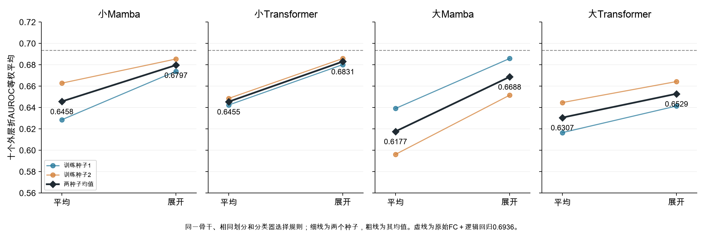

# 最新结果与解释

截至2026年10月24日，以下两批已完成，残差相关新目标四组尚在运行。

## 展开和分类头

固定预训练骨干和逻辑回归，平均改为展开后，小Mamba AUROC 0.6458→0.6797，小Transformer 0.6455→0.6831，大Mamba 0.6177→0.6688，大Transformer 0.6307→0.6529。两个种子方向一致。展开同时增加分类器输入维数，不能把全部增益归于已量化的疾病信息恢复。

原始FC＋逻辑回归为0.6936，尚高于四种预训练路线。SVM、单隐藏层32ReLU的MLP没有一致优于逻辑回归。当前MLP概率误差较大，拟合迭代上限警告已保留，不据外层成绩追加训练。

## 预训练阶段

|模型|随机|5轮|20轮|40轮|最终|
|---|---:|---:|---:|---:|---:|
|小Mamba|0.6948|0.6928|0.6821|0.6743|0.6797（94轮）|
|大Mamba|0.6953|0.6845|0.6856|0.6686|0.6688（48轮）|
|小Transformer|0.6441|0.6773|0.6602|0.6748|0.6831（100轮）|
|大Transformer|0.6685|0.6769|0.6709|0.6625|0.6529（97轮）|

随机指编码器未预训练，后接分类器仍使用训练标签拟合，不是随机猜标签。指标为十个外层折AUROC等权平均，再平均两个种子。

小Mamba两种子在5至40轮都下降，大Transformer阶段均值下降；大Mamba种子走势不同，小Transformer后期恢复。这不支持全部模型都有统一的后期过拟合拐点。只检查了指定轮次，不对缺失轮次插值；不以外层测试成绩选择“最佳模型”。

## 新目标实验

四组为小Mamba／小Transformer，各比较原MSE与MSE＋个体残差相关约束。其他结构、遮挡与分类流程固定；lambda仅按当前训练部分的初始化梯度量级规则确定。此处只有设计，没有最终改善结论。

## 2026年10月25日状态更新

残差相关目标四组已完整结束，主分类指标未显示收益。新一轮编码器表示一致性正在短程核验和启动流程中，尚无结果。旧文中的“残差相关进行中”仅为历史记录。
[残差相关目标完整结果](残差相关目标结果.md)

## 2026年10月25日完成更新

表示一致性四组已全部完成并核验，小Mamba AUROC 0.6864→0.6631，小Transformer 0.6816→0.6759，当前配方未显示一致分类收益。旧文“进行中”为历史记录。

[本轮结果](表示一致性结果.md) · [10月27日组会图文稿](组会汇报/20261027/README.md)

## 本轮曲线附录已补齐

[最新真实loss、梯度与学习率](表示一致性训练曲线.md)。原始日志仅私有归档，公开图不含个体数据。实验已完成，不再自动启动新实验。
