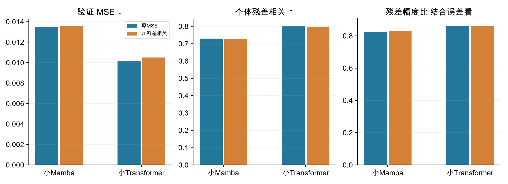

# 残差相关目标四组完整结果

## 残差相关目标的上游结果

40项上游、8项全量重拟合、8组冻结特征和8项分类已完成。新增相关约束未带来共同验证重建指标的改善。

**设置：**四组为小Mamba/小Transformer，各比较原MSE与MSE加残差相关。原脑区token、方块对称遮挡和模型不变。上游610人五折、双种子，每次100轮；每组按原验证MSE的十个运行均值选轮。

**结果：**Mamba原MSE/新增约束：MSE 0.013501/0.013603，相关0.7297/0.7280，幅度比0.8255/0.8314。Transformer：MSE 0.010156/0.010510，相关0.8036/0.7962，幅度比约0.8628/0.8628。

**问题与解释：**新增项两架构的验证MSE均更高。Mamba幅度比略接近1，但不能单独判为改善。训练相关项用对称化上三角；这里沿用原共同验证指标，不能把新增训练项降低直接当作有效。所选轮次MS原94/新增97，TS两组100。

## 残差相关目标的下游结果

固定冻结骨干完整展开33408维＋逻辑回归。四个配对种子的AUROC均未提高，按预先规则进入编码器表示一致性对照。

**设置：**使用原290人和10外层×3内层，六档C及训练折内标准化不变。80个外层折核对源文件摘要、特征与权重、受试者顺序并重算指标；无新增骨干或分类器候选。

**结果：**小Mamba AUROC 0.6797→0.6726，BCE 0.8145→0.9404，准确率60.86%→62.07%。小Transformer AUROC 0.6831→0.6809，BCE 0.7868→0.7358，准确率62.59%→61.90%。原始FC AUROC 0.6936。

**问题与解释：**排序、准确率和概率质量并不一致变化；不能只挑改善的指标宣布成功。当前配方没有一致收益，不等于所有个体差异目标都无效。后续唯一授权批次是两视图MSE与加入ROI表示一致性，先做短程与防退化检查；不叠加残差项、不扩容量、不据外层测试调参。290人是反复开发队列，非新盲测。
