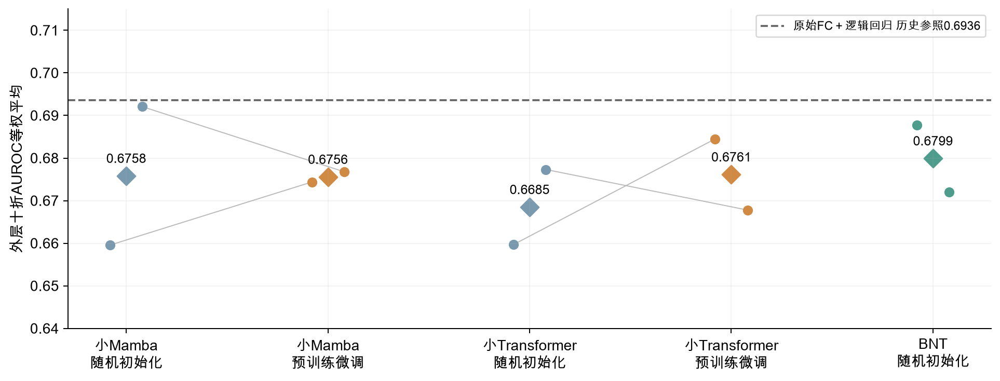
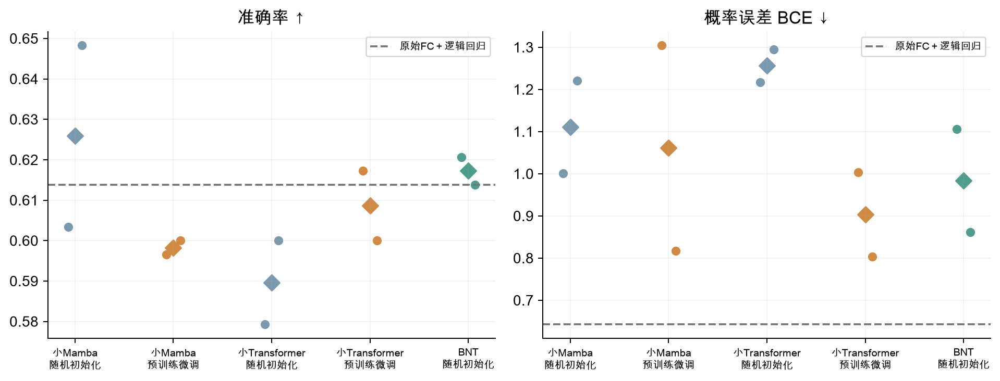
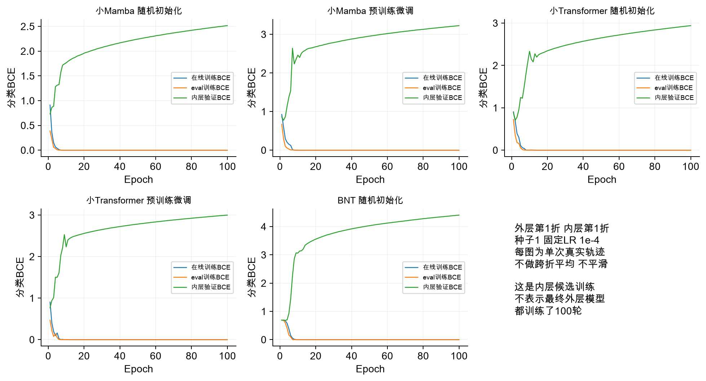
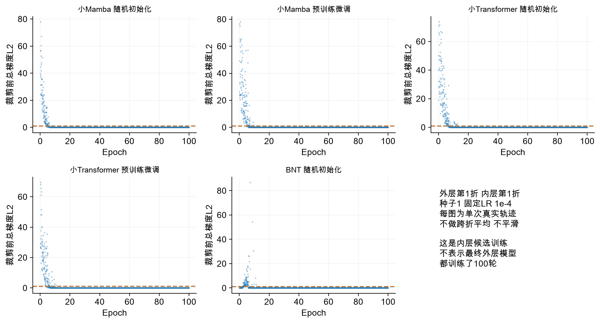
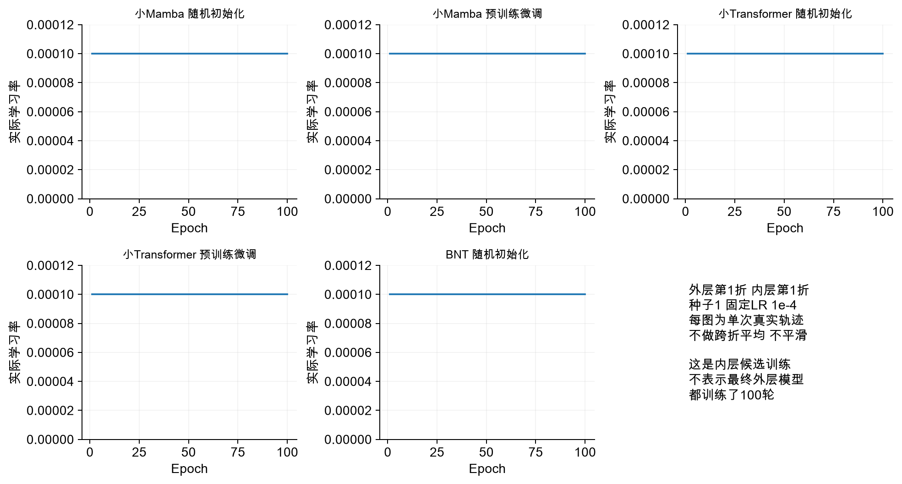
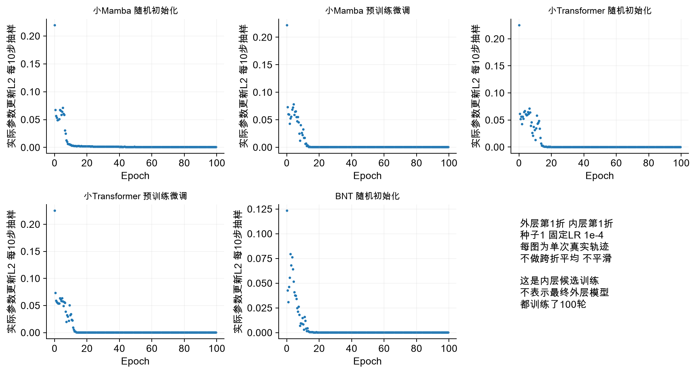
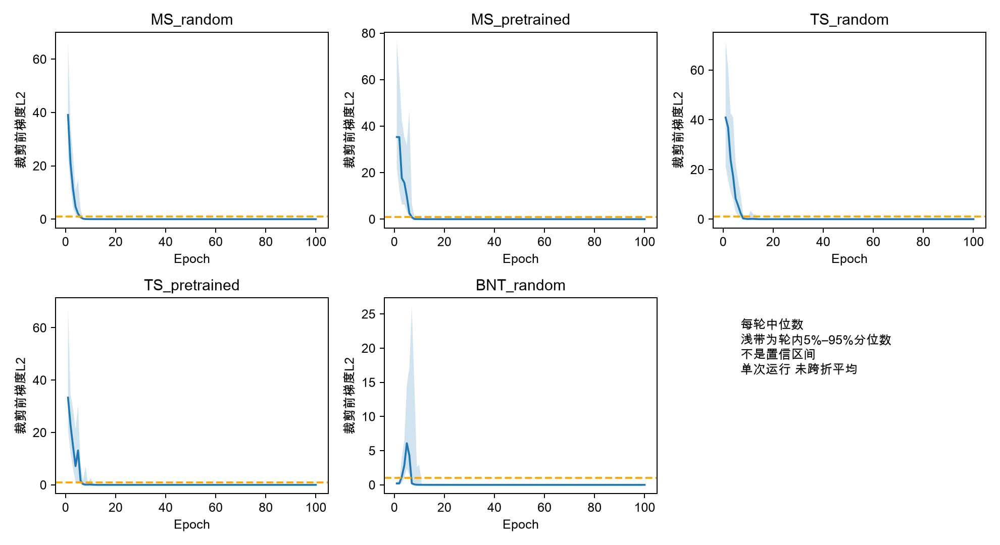

# 监督迁移与BNT五组分类结果

600次内层拟合与100次外层拟合已完成  2026年10月26日

**为什么做：**此前冻结骨干分类没有稳定获益。本轮检验原MSE预训练是否仍能作为有用初始化：允许编码器随疾病分类损失更新；另加入BNT完整模型作结构参照。

**比较设置：**小Mamba和小Transformer分别比较随机初始化与原MSE预训练初始化，均为完整FC、展开33408维、线性分类头并联合训练。BNT采用官方结构在本地协议下适配，不是单独替换池化，也不是论文成绩复现。

**实际结果：**两种子平均AUROC：Mamba随机0.6758、预训练0.6756；Transformer随机0.6685、预训练0.6761；BNT为0.6799。原始FC＋逻辑回归历史参照0.6936。每个圆点为一个种子的十折均值，菱形为两种子均值。

**汇报时怎么说：**允许骨干更新之后，预训练没有表现出跨种子一致的优势。Transformer平均有提升，但两个种子方向不同；Mamba均值基本相同。BNT也没有超过原始FC参照，所以当前不能把新模型或微调方案作为已经胜出的方案。

# 排序能力与概率质量要分开判断

AUROC为主指标  准确率与BCE分别反映阈值表现和概率误差

**为什么做：**只看AUROC会漏掉预测概率质量。分类排序变化、固定阈值准确率和BCE可能方向不同，需要一起报告。

**实际结果：**Mamba随机/预训练：ACC 62.59%/59.83%，BCE 1.1106/1.0609；Transformer随机/预训练：ACC 58.97%/60.86%，BCE 1.2559/0.9036；BNT：ACC 61.72%，BCE 0.9833。原始FC参照BCE约0.6432，当前五组均更高。

**配对与边界：**Mamba预训练相对随机的AUROC变化为种子1 +0.0148、种子2 −0.0153；Transformer为 +0.0248、−0.0095。两种子不是独立人群，也未做显著性检验。历史冻结LR使用特征标准化和不同优化器，不能将历史与本轮差异全部解释为解冻作用。

**汇报时怎么说：**平均成绩容易掩盖种子分歧。这轮两个架构都出现一个种子改善、另一个下降。概率误差也较大，说明即使平均AUROC略有提高，仍不能称模型整体更可靠。

# 真实分类loss显示后期泛化风险

外层第1折 内层第1折 种子1 固定1e-4  五个单次候选轨迹

**图里是什么：**蓝线为在线训练BCE，橙线为eval模式训练BCE，绿线为内层验证BCE。这里没有重建损失，也没有外层测试集的逐轮曲线。所有点来自真实epoch记录，不做跨折平均或平滑。

**对应参数：**完整FC、batch8、AdamW、weight decay 0.01、梯度裁剪1、固定LR 1e-4、100轮。五组展示相同设置便于检查过程，不是依据结果挑出的最佳曲线。BNT含其官方结构的dropout0.1，主四组保留原骨干结构。

**结果与问题：**这五条候选训练的eval训练BCE最后接近0，而内层验证BCE持续增大，显示明显的后期过拟合与概率质量恶化。图中的100轮只是内层候选搜索范围；最终外层模型按三内层平均AUROC选择轮次，并非一律训练100轮。各组最终轮次中位数约4～7轮。

**汇报时怎么说：**网络很快拟合训练数据，但验证概率误差没有随之改善。这是我们不能只看训练loss的直接证据。我们已按预定内层流程选轮，外层结果仍没有稳定胜出，因此不继续靠延长训练来追成绩。

# 梯度记录与评价流程核查

逐步总梯度与每轮分模块统计均保留  未读取66人留出

**图里是什么：**散点是实际分类总目标的裁剪前梯度L2，虚线1为裁剪阈值；每轮22个训练步。不同模型参数量和结构不同，绝对范数不能作为跨架构优劣评分。梯度变小也可能只是训练样本已拟合，并不代表验证改善。epoch统计、学习率和实际更新量另见HTML附录与记录。

**评价与选轮：**原290人十折外层261/29，每个外层训练侧做三折174/87；两档LR 1e-5/1e-4各100轮。每组、种子、外层按三内层平均AUROC选择LR和轮次，同分更低BCE、再更早轮次和更小LR。随后重新训练外层261人，外层29人只在结束时评价一次。

**完成核查：**600个内层和100个外层权重摘要已核对；100项选择重新由内层曲线计算并一致；240组配对分类头初值一致。数据、代码和原预训练权重摘要不变，外层结果已重算。290人反复用于研究开发，仍不称为新盲测。

**汇报时怎么说：**优化过程和数据边界已经记录并核查，现有证据不足以证明预训练微调或BNT稳定优于参照。建议先讨论小样本下的正则化、概率质量和站点混杂，再预先设计下一步；本轮结束后没有自动追加实验。

## 学习率和参数更新附录

