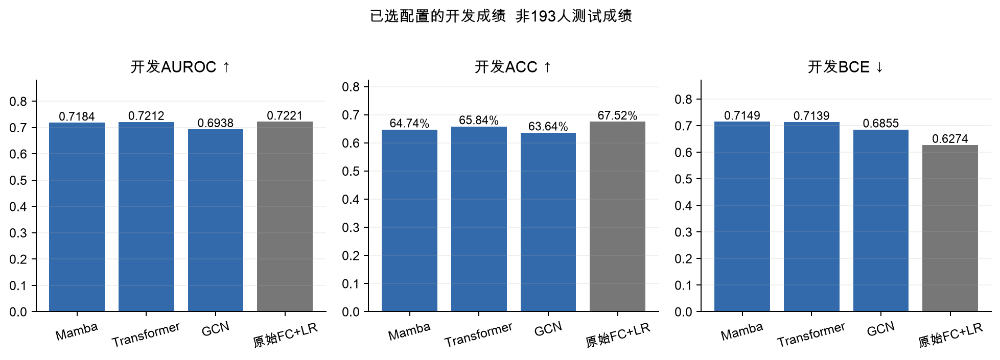
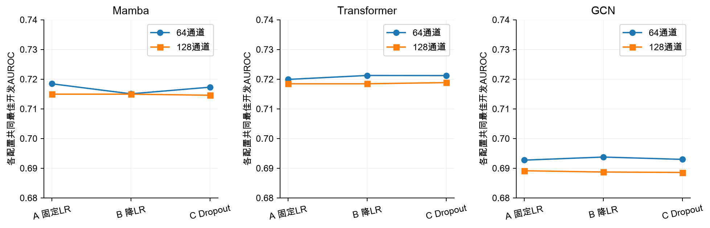
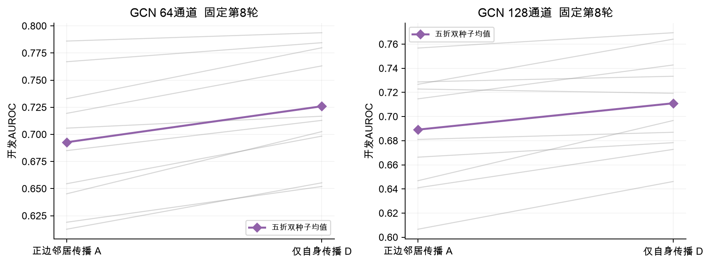
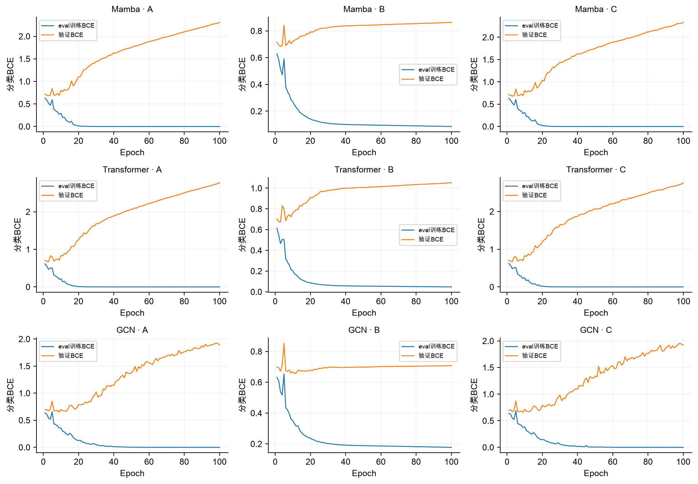
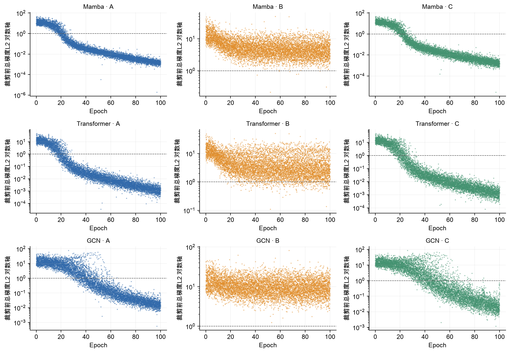
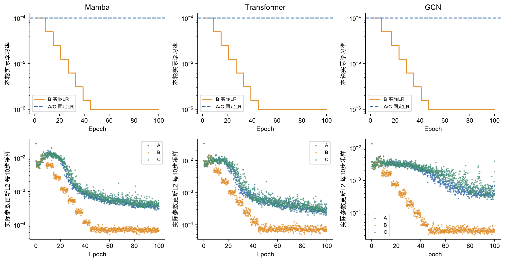
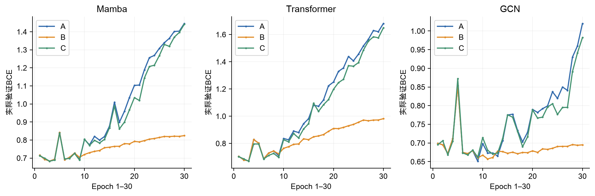

# DirectFC v1.3 开发完整结果

**状态：237项拟合完成，7份模型冻结，193人测试未评分。**

## 完整开发与选定模型

200项神经开发、30项逻辑回归开发与7项最终重拟合全部完成；总计237项。01:15启动、09:02结束，约7小时47分。测试集仍锁定。

**图是什么：** 比较冻结选择规则选出的开发配置；不是最终193人测试成绩。神经网络为五折等权再两种子平均，LR为五折均值。ACC固定阈值0.5。

**结果：** Mamba64固定LR第10轮：AUROC0.7184，ACC64.74%；Transformer64降LR第10轮：0.7212，65.84%；GCN64降LR第11轮：0.6938，63.64%。原始FC+LR C=0.001：0.7221，67.52%，BCE0.6274。

**怎么看：** 神经网络尚未在这张开发表超过LR；三个架构都选64通道。开发分数参与选参，偏乐观，不能宣称独立测试胜负。两种子不是两个人群。

**汇报时怎么说：** “这轮先把数据和候选统一。237项计算完成，但测试还没打开。开发结果中，线性参照仍有竞争力，复杂网络尚未显示明确优势。”

## 调度与Dropout的作用

A固定1e-4；B只增加验证BCE平台期降LR；C固定1e-4，仅线性头前Dropout0.1。每个配置均五折双种子、完整100轮。

**为什么比较：** 分别检验调整学习率和轻量正则化，保持初始化、样本顺序及其余设置配对；没有B+C联合组。图中连接线是配置对比，不是时间曲线。

**结果：** 64通道A/B/C AUROC：Mamba0.7184/0.7151/0.7173；Transformer0.7199/0.721230/0.721197；GCN0.6927/0.6938/0.6930。B与C在Transformer上差约0.000033，不能说B明显更好。

**问题：** 每个配置用自身共同最佳轮次汇总，因此只是开发最优比较。降LR明显减轻末轮BCE恶化，却没有大幅提高早期最高AUROC；头前0.1 Dropout也未解决后期过拟合。

**汇报时怎么说：** “调度主要改变训练后半段的恶化程度，不能只因为曲线更平就说分类能力明显提升。Dropout的结论也只针对当前位置和强度。”

## GCN邻居传播是否有帮助

D与A-GCN结构、参数量、初始化和输入配对，只把归一化传播矩阵换为I。输入仍包含完整正负FC。D不参与最终模型选择。

**图是什么：** 统一在A各宽度选出的第8轮读取A和D。灰线为同fold同seed配对，粗线为十次运行均值；不是十个独立队列。

**结果：** 64通道AUROC从0.6927到0.7259，10/10配对提高；128通道从0.6891到0.7110，9/10配对提高。两个种子的均值差均为正。

**怎么看：** 支持当前正边667条、两层GCN的邻居聚合没有带来收益，可能损害表现；不能仅据此证明过平滑或所有图模型无效。D保留完整FC特征，不能称没有网络信息。

**汇报时怎么说：** “最有价值的机制信号是：在相同训练轮次，保留自身特征比加入当前邻居聚合更好。下一步解释应集中在传播和建图，但本轮不临时把D加入测试候选。”

## 真实单次分类loss

固定展示第1开发折、种子1、64通道；九个小图分别对应三架构×A/B/C。每条线来自一次真实训练，无平滑、无折平均。

**图是什么：** 蓝线为eval模式训练BCE，橙线为验证BCE；C组关闭Dropout后评价训练集，避免将随机屏蔽效应误当泛化差距。online BCE另存原始记录。

**怎么看：** 训练误差下降同时验证误差上升，显示后期过拟合。跨折均值中，64通道第100轮A/B验证BCE为Mamba2.271/0.900、Transformer2.888/1.039、GCN2.202/0.782；这些均值是补充数字，不是图中曲线。

**汇报时怎么说：** “模型能拟合训练集，但长时间训练让验证概率误差变大。最终模型按开发规则只重拟合到10或11轮，没有采用严重过拟合的第100轮。”

## 真实逐步梯度

与上一页相同的第1折、种子1、64通道九次运行。散点为每个实际更新步的裁剪前总梯度L2，纵轴为对数坐标；虚线为裁剪阈值1。

**梯度是什么：** 这是分类BCE对当前所有可训练参数的梯度范数，包含输入映射、骨干、输出Norm和分类头；没有重建Decoder。不是重建MSE梯度。

**怎么看：** 小批次波动和偶发尖峰不直接等于爆炸；需同时看非有限值、loss、裁剪比例和实际更新。总梯度受模型参数量与训练状态影响，不能按绝对高低给架构排名。

**汇报时怎么说：** “梯度图用于判断优化是否稳定、是否频繁裁剪；它不能替代验证指标。即使梯度变小，验证表现仍可能恶化。”

## 学习率与实际参数更新

固定第1开发折、种子1、64通道。上排是B组每轮实际使用LR，A/C保持1e-4；下排仅画每10步真实保存的参数更新采样点。

**为什么放一起：** AdamW下参数更新不等于学习率乘原始梯度；同时展示两者，避免把梯度下降直接解释为参数几乎不再学习。

**最终设置：** Transformer与GCN选中B，最终重拟合按十条开发实际LR轨迹逐轮取低中位数重放：第1–8轮1e-4，第9轮起5e-5；分别到第10、11轮。全开发没有用测试集驱动调度。

**边界与状态：** 已有历史用途披露；966中89例any_fail标记保留，家庭信息未知。193人测试未评分。开发模型、scaler、源码和选择hash已冻结，开启测试需单独明确指令。

**汇报时怎么说：** “训练后期的改善主要体现在更受控的更新与概率误差，但是否能泛化仍要看已锁定模型的终点评价。”

## 完整配置与两种子结果

每配置共同选轮，D自身最优仅描述；主要诊断仍用A第8轮。以下为模型级汇总，无逐人数据。

|arm|condition|width|seed|common_epoch|AUROC|ACC|BCE|sensitivity|specificity|diagnostic_only|
|---|---|---|---|---|---|---|---|---|---|---|
|Mamba|A|64|1|10|0.7135528110803753|0.6519648093841642|0.7116431947817423|0.571714179933358|0.7246913580246914|False|
|Mamba|A|64|2|10|0.7233144158748347|0.6429241726015921|0.7180695467605899|0.571380970011107|0.7072869617585065|False|
|Mamba|A|128|1|5|0.7110882460587328|0.6571093422706326|0.6980300464236985|0.6011477230655313|0.707347184582957|False|
|Mamba|A|128|2|5|0.7187787631712345|0.648051948051948|0.6989561478888476|0.620918178452425|0.6732008431195423|False|
|Transformer|A|64|1|10|0.714121338177469|0.6454796816087138|0.7400596054593975|0.6261754905590522|0.6632640770852152|False|
|Transformer|A|64|2|10|0.7256729610777947|0.6688060326770005|0.7630728660943148|0.6037763791188449|0.7268593797049081|False|
|Transformer|A|128|1|5|0.7173220553218325|0.6688227901131126|0.7345196324942845|0.6280636801184746|0.7049984944293887|False|
|Transformer|A|128|2|5|0.7195418494560937|0.6442396313364056|0.749935297325462|0.648611625323954|0.6414634146341462|False|
|GCN|A|64|1|8|0.6911043909484715|0.6273481357352325|0.6764464423663933|0.5988893002591633|0.6532971996386631|False|
|GCN|A|64|2|8|0.6943216855345155|0.6324675324675324|0.6657458094727937|0.5789337282487967|0.6804275820535983|False|
|GCN|A|128|1|8|0.6800084637483013|0.6261667364893171|0.8042833366522695|0.4155497963717142|0.8154170430593194|False|
|GCN|A|128|2|8|0.6982703942387649|0.6196899874319229|0.7683110610614924|0.4977045538689374|0.729177958446251|False|
|Mamba|B|64|1|10|0.7120291691624802|0.6623125261834939|0.6824888323784479|0.5903369122547205|0.7271604938271604|False|
|Mamba|B|64|2|10|0.7180808718285052|0.6467783829074152|0.7126673866583348|0.5628285820066642|0.7221017765733213|False|
|Mamba|B|128|1|5|0.7110882460587328|0.6571093422706326|0.6980300464236985|0.6011477230655313|0.707347184582957|False|
|Mamba|B|128|2|5|0.7187787631712345|0.648051948051948|0.6989561478888476|0.620918178452425|0.6732008431195423|False|
|Transformer|B|64|1|10|0.718605608615632|0.6545705906996229|0.7112161634123053|0.6094779711218068|0.6952423968684129|False|
|Transformer|B|64|2|10|0.7238546152790502|0.6623292836196063|0.71654361820758|0.5848204368752314|0.732008431195423|False|
|Transformer|B|128|1|5|0.7173220553218325|0.6688227901131126|0.7345196324942845|0.6280636801184746|0.7049984944293887|False|
|Transformer|B|128|2|5|0.7195418494560937|0.6442396313364056|0.749935297325462|0.648611625323954|0.6414634146341462|False|
|GCN|B|64|1|11|0.6920616016395055|0.6429157938835358|0.6846876967176796|0.5955942243613477|0.6853959650707618|False|
|GCN|B|64|2|11|0.6954506683986581|0.6298701298701298|0.6863433478600829|0.5683080340614588|0.6850045167118338|False|
|GCN|B|128|1|6|0.691480644248213|0.6143862589023878|0.7388630099893616|0.6567567567567567|0.5767841011743451|False|
|GCN|B|128|2|6|0.6859478589849456|0.6132216170925849|0.7258803146865971|0.7266567937800814|0.510960554049985|False|
|Mamba|C|64|1|10|0.7113322923101295|0.650674486803519|0.7038537593574665|0.571714179933358|0.722312556458898|False|
|Mamba|C|64|2|10|0.7232432231764006|0.6416170925848346|0.7112765774396401|0.5740466493891152|0.7023788015657935|False|
|Mamba|C|128|1|6|0.7202475891639495|0.6479765395894428|0.7215535154017791|0.6702332469455757|0.6284552845528455|False|
|Mamba|C|128|2|6|0.7088781063054368|0.6493757855048177|0.702534066892756|0.6914105886708627|0.6116531165311654|False|
|Transformer|C|64|1|8|0.7205348237200337|0.6610389610389611|0.6795418723638911|0.6151055164753795|0.7024992472146945|False|
|Transformer|C|64|2|8|0.7218597927474194|0.6610054461667365|0.6843261267328026|0.5848944835246204|0.7299909665763324|False|
|Transformer|C|128|1|5|0.7180263234612271|0.6739924591537495|0.7156801673890113|0.6279896334690855|0.7146943691659138|False|
|Transformer|C|128|2|5|0.7196217489345901|0.6312777545035609|0.7316525427393193|0.6540170307293595|0.6118337850045167|False|
|GCN|C|64|1|9|0.6870875441651696|0.62865521575199|0.6990505794256258|0.6008145131432803|0.6535682023486902|False|
|GCN|C|64|2|9|0.698843358337734|0.6389694176790951|0.6636445569494356|0.6526471677156609|0.625925925925926|False|
|GCN|C|128|1|6|0.692319616643038|0.6143611227482195|0.7458605789359336|0.6403554239170677|0.5912978018669076|False|
|GCN|C|128|2|6|0.6848099352275764|0.6002681189777964|0.7262995083715111|0.7019622362088115|0.508641975308642|False|
|GCN|D|64|1|10|0.727598787115437|0.6688311688311688|0.6641020921412327|0.5689374305812662|0.7590183679614574|True|
|GCN|D|64|2|10|0.7354518010604435|0.654444909928781|0.6566591220460813|0.6065531284709367|0.6971093044263775|True|
|GCN|D|128|1|6|0.7168337955953503|0.633782991202346|0.7042025279834978|0.6401332839689005|0.6282143932550437|True|
|GCN|D|128|2|6|0.7131586314011973|0.6610138248847925|0.677147205962511|0.663680118474639|0.6585666967780789|True|

## 附录

237项拟合结束，测试仍锁定；不含原始数据、逐人预测、特征或权重。私有证据范围见本次发布说明。
