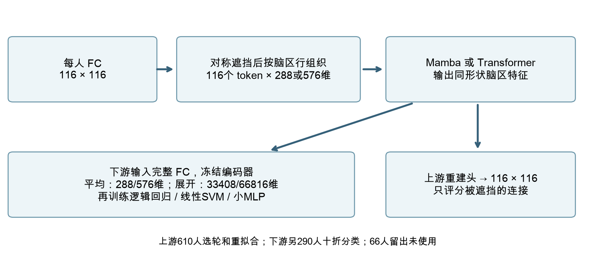
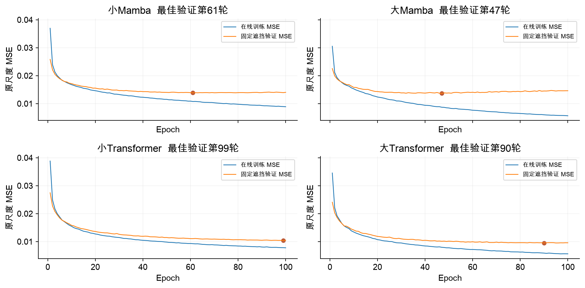
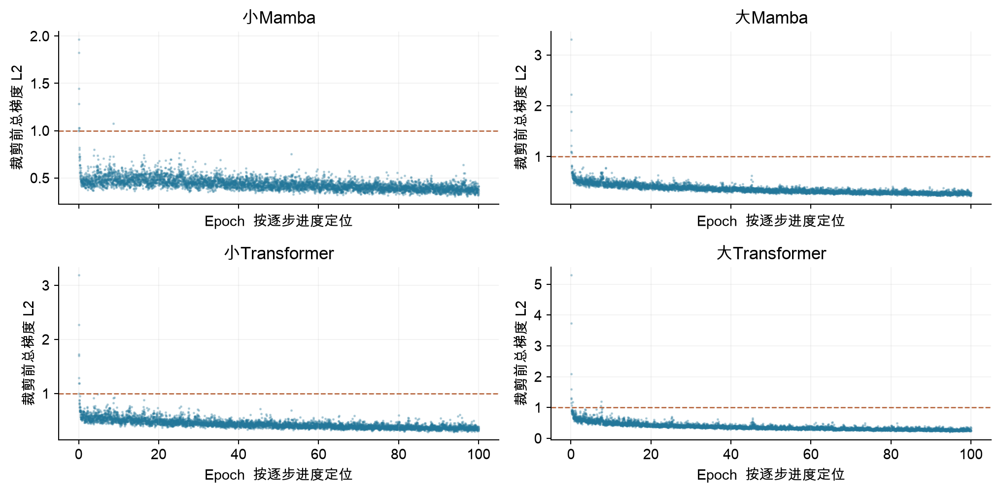
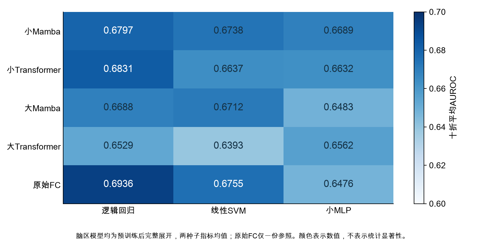
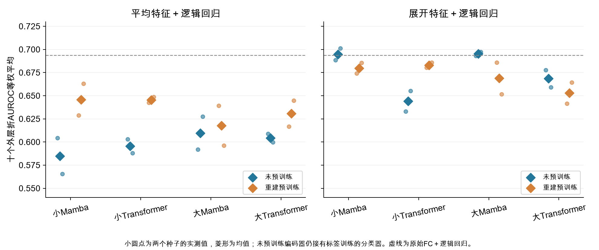
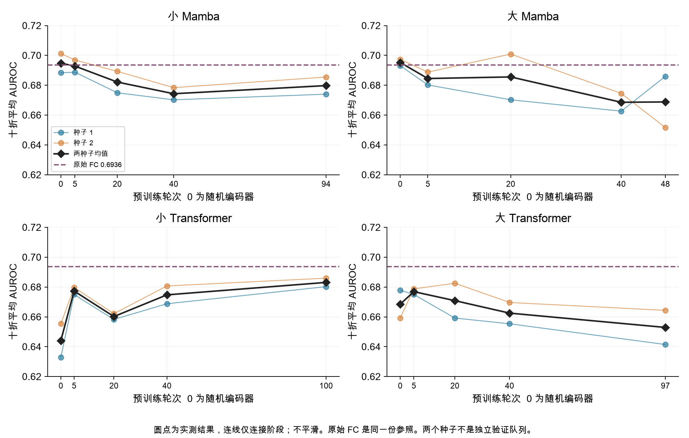
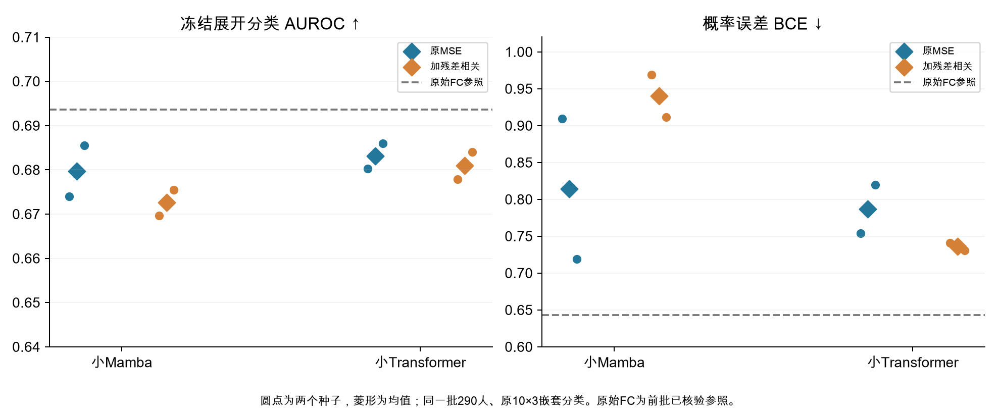
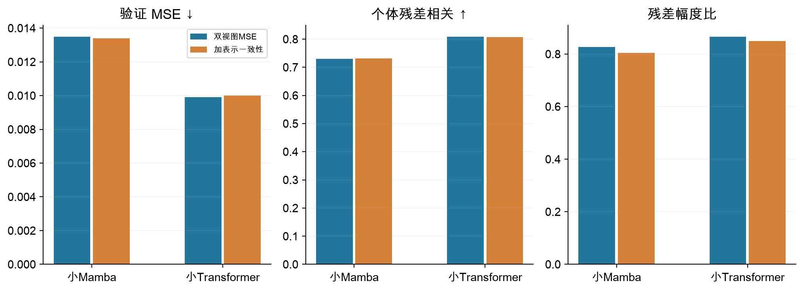
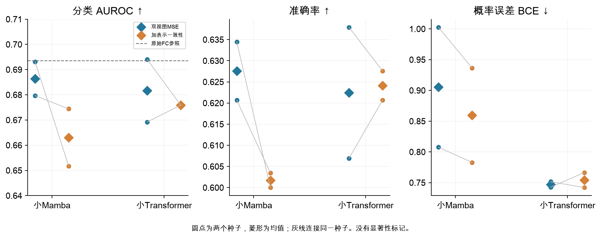

> 2026年10月25日补充：[实验口径与来源核查](口径与来源补充/先读这个_实验口径补充.md)。制作PPT优先核对单次最佳轮次与最终重拟合、实际学习率调度和13图来源。仅补既有记录，未新增实验。

# 周二组会图文汇报

[下载Word图文稿](周二组会_图文汇报与讲稿.docx)

## 脑连接重建与疾病分类研究进展

2026年10月27日组会  结果截至10月25日14时06分

**本次要回答的问题：**重建误差降低，为什么没有稳定转化为疾病分类提升？先检查模型和读出，再检查预训练阶段，最后对照两种训练目标。

**模型与设置：**FC为116×116。每个脑区的一行连接值、遮挡指示分别投影，再加可学习ROI身份向量。小模型为116×288，大模型为116×576。Mamba为4个双向块；Transformer为5块6头自注意力。小模型重建头为LayerNorm＋线性层；大模型先降到288维，再用2个相应结构块重建。

**数据与评价：**上游610人，五折内每次488人训练、122人验证；验证选轮后用全部610人重拟合。下游另290人，冻结编码器，10外层×3内层选择分类参数。66人留出未使用。重建解码器不参加下游分类。

**汇报时怎么说：**这次我主要汇报重建表征与疾病分类之间的差距。我们先排查平均池化和分类头，再检查训练到不同阶段的变化，最后做训练目标对照。290人已用于多轮开发，因此这里是探索性开发结果，还不是新的独立盲测。

## 先确认模型是否正常学习

原始单次运行  第1折 种子1  不做五折平均 不平滑

**为什么做：**比较大小模型的训练与验证走势，判断重建收益、平台期和过拟合迹象，避免仅凭最终训练loss判断模型。

**对应参数：**四组均为脑区token、50%对称方块遮挡、batch 8、100轮、AdamW、固定学习率1e-4、weight decay 0.01、梯度裁剪1。小Mamba约5.00M、小Transformer约5.13M、大Mamba约22.02M、大Transformer约22.34M。此页是历史固定学习率对照，不是最新双视图训练。

**结果说明什么：**小Mamba验证约60轮后趋于平台；大Mamba后半程训练继续下降而验证回升，过拟合迹象更明显。小Transformer验证改善更持续，大Transformer重建误差更低。大小配置同时改变宽度和重建头，不能把变化全部归因于编码器容量。训练与验证遮挡、采样条件不同，差距本身不是唯一判据。

**汇报时怎么说：**Transformer在这个遮挡重建任务上确实学得更好；大Mamba则出现了后期验证恶化。所以我们不能只扩大模型，也不能把训练误差一直下降当成有效学习。下面还要检验这些重建表征能否帮助分类。

## 梯度波动是否意味着训练异常

每个点是一批数据的一次更新  虚线为裁剪阈值1

**为什么做：**确认模型持续收到学习信号，是否有数值发散或异常梯度，并把优化稳定性与泛化能力分开。

**图里是什么：**纵轴是重建损失对可训练参数求导后，所有梯度合起来的L2范数；这里画裁剪前总梯度。横轴按每轮61个更新步定位。所有逐步记录均保留，没有取轮内中位数。对应上一页同一运行，学习率全程1e-4。

**正常与需要关注：**逐批梯度波动、少量尖峰可以正常出现。超过虚线表示需要裁剪，不等于训练已爆炸。需结合持续非有限值、loss发散、长期近零和实际参数更新判断。不同参数量的总范数不能直接作为优劣分数；AdamW有动量和自适应缩放，实际更新也不等于学习率乘当前梯度。

**汇报时怎么说：**这些图看的是每一步优化信号，不是疾病信息的多少。模型可以梯度正常、数值稳定，同时在验证集上过拟合。所以梯度用于检查优化是否异常，模型效果仍要看验证重建和独立的分类评价。

## 先改变读出方式保留脑区差异

同一冻结编码器  固定逻辑回归  只比较平均与展开

**为什么做：**平均池化把116个脑区的特征汇成一个向量，可能丢掉不同脑区之间的差异。先保持骨干和分类器相同，只改变送入分类器的特征。

**具体怎么做：**小模型116×288平均为288维，展开为33408维；大模型116×576平均为576维，展开为66816维。展开发生在下游编码器之后，没有把长向量重新送入上游，也没有重训骨干。标准化和正则化选参只在各分类训练侧完成。

**结果说明什么：**两种子平均AUROC：小Mamba 0.6458→0.6797，小Transformer 0.6455→0.6831，大Mamba 0.6177→0.6688，大Transformer 0.6307→0.6529。展开在四种预训练模型中均改善，但仍低于原始FC＋逻辑回归的0.6936。

**汇报时怎么说：**老师建议保留完整骨干特征后，我们确实看到平均池化是一个限制。展开改善了分类，但还不能说明预训练已经有效，因为它仍没有超过直接使用原始FC的参照。

## 再检查是否是分类头能力不够

固定完整展开特征  对比逻辑回归 线性SVM 小MLP

**为什么做：**排查线性分类器是否限制了表征利用，避免把分类头能力不足误认为骨干没有学到信息。

**分类头结构：**逻辑回归是线性得分再用Sigmoid输出概率，没有隐藏激活层。线性SVM也是线性决策面，原始分数不是概率。小MLP包含32单元的ReLU隐藏层，再输出二分类概率；其复杂度和训练难度更高。

**结果与边界：**线性SVM和小MLP没有一致优于逻辑回归。跨分类器主要比较逐外层折AUROC的平均值；拼接SVM分数只作辅助。BCE只对概率输出计算。部分MLP拟合达到200轮上限，警告保留，不能据此断言所有MLP都无效，也没有根据外层结果增加轮数。

**汇报时怎么说：**换分类头后没有看到稳定收益，因此当前问题不太像只靠一个更复杂的分类器就能解决。不过MLP还有收敛和概率质量问题，这次结果只约束当前小MLP配置，不能推广到所有非线性分类器。

## 用随机编码器检查预训练的净收益

随机表示是未预训练的编码器输出  不是随机猜标签

**为什么做：**展开后的高维表征可能仅凭随机投影也保留了原始FC信息。必须将预训练骨干与同架构随机初始化骨干对比，才能区分读出收益和预训练收益。

**比较条件：**随机编码器权重冻结，同样输入完整FC、提取平均或展开特征，再训练下游分类器。分类器仍使用真实标签训练；所以随机编码器的AUROC可以高于0.5。种子1和2对应两次预训练或随机初始化实现，不是两份独立人群。

**结果说明什么：**随机小Mamba展开AUROC约0.6948，随机大Mamba约0.6953，均具有较强表现。预训练Mamba没有显示额外分类收益。这提示重建目标可能改变了原本可被分类利用的结构，但还不能证明骨干完全没有学习，或全部个体差异都被抹掉。

**汇报时怎么说：**随机参照很关键：它说明高维展开本身已经能保留一部分分类信号。我们现在要问的是预训练在此基础上增加了什么，而不是只看预训练模型有没有超过随机猜测。

## 检查分类表现在哪个训练阶段变化

固定展开加逻辑回归  使用既有检查点  没有重训骨干

**为什么做：**如果重建目标逐渐改变了对分类有用的表征，那么早期、中期和最终阶段的分类表现可能不同。

**怎么比较：**评估随机初始化、第5、20、40轮及各模型既定最终轮次。新增24组特征和24项分类；最终、随机和原始FC参照复用已核验结果。图中的线只连接实际测量点，不表示未测轮次的真实走势。

**结果说明什么：**小Mamba由随机约0.6948，经第5轮0.6928、第20轮0.6821、第40轮0.6743，到最终0.6797，整体没有预训练净收益。小Transformer则从随机约0.6441提升到最终0.6831；不同架构的轨迹不同，不能统一说预训练越久越差。

**汇报时怎么说：**阶段检查把问题缩小了一步：Mamba的分类收益并没有随着重建训练稳定累积，但Transformer有不同表现。这支持继续检查目标与表征的关系。我们只把它作为诊断，没有用外层分类成绩挑选最佳上游轮次。

## 第一种目标调整约束重建的个体残差

原MSE 与 原MSE加残差相关  单视图对照批次

**为什么做：**重建可能更容易拟合人群共同结构，因此尝试让预测保留相对训练人群平均FC的个体变化方向。残差是个人FC减去该训练折的人群平均FC。

**怎么控制条件：**小Mamba和小Transformer各比较原MSE与新增相关项，其他模型和遮挡条件不变。权重lambda按各上游训练折初始化梯度量级固定，未按下游成绩选择。40项上游、8项重拟合、8项分类全部完成。

**结果说明什么：**小Mamba AUROC 0.6797→0.6726；小Transformer 0.6831→0.6809，四个配对种子均未提高。共同验证MSE也没有改善。Mamba准确率、Transformer概率误差有局部改善，说明各指标并不等价；不能只挑改善的一项宣布成功。

**汇报时怎么说：**残差相关有明确动机，但当前固定配方没有带来预期分类收益。这个结果不说明所有个体差异目标都无效，只说明这项重建输出约束在目前条件下没有解决问题。下一步因此转向直接约束编码器表征。

## 第二种目标调整直接约束脑区表征

新双视图MSE参照 与 加表示一致性  本轮已完整结束

**为什么做：**希望同一个人在两种遮挡输入下仍形成较稳定的脑区表征，同时避免只依靠固定ROI身份或所有人输出相同特征满足目标。这里只检验遮挡稳定性，不是跨扫描可靠性。

**怎么做与参数：**对照与实验都用两种独立对称方块遮挡，平均两视图MSE。新增项在每个ROI、每个通道沿受试者批次轴中心化，包含一致性、标准差下限0.1与0.04倍协方差约束；无投影头、不先平均ROI。lambda按训练内梯度比例固定，折内约0.0543～0.0606，全610为0.06122。属于VICReg启发的适配，不是原方法复现。

**上游结果：**Mamba验证MSE 0.013495→0.013395，相关0.7300→0.7308，幅度比0.8268→0.8048；Transformer MSE 0.009912→0.010003，相关0.8088→0.8070，幅度比0.8662→0.8486。Mamba误差略降，但幅度收缩更强；不能把这几个指标混成一个“更好”。

**汇报时怎么说：**这一轮把约束放到编码器本身，而且对照也使用同样两次前向，匹配计算预算。Mamba重建误差有小幅改善，但个体变化幅度更小，所以我们必须继续看分类，不能在上游就宣布方法有效。

## 最新分类结果没有出现一致收益

40上游 8重拟合 8组特征 8项分类 80外层折核验通过

**比较口径：**仍为冻结骨干、展开33408维、原290人10×3分类和同一逻辑回归实现。新双视图参照与新增约束配对比较，不能把上一批单视图参照当成本批严格对照。

**实际结果：**小Mamba平均AUROC 0.6864→0.6631，两个种子都下降；准确率62.76%→60.17%，BCE 0.9052→0.8596。小Transformer AUROC 0.6816→0.6759，一个种子上升、一个下降；准确率62.24%→62.41%，BCE 0.7471→0.7542。原始FC参照AUROC为0.6936。

**结论与限制：**当前固定配方没有稳定改善分类。Mamba的MSE略降而AUROC下降，再次说明重建误差不能替代疾病分类评价；BCE改善也不等于排序能力改善。只有两个种子，小批次方差与协方差估计有噪声，不能将小差异直接称为显著，也不能宣布所有一致性方法失败。

**汇报时怎么说：**这轮结果出来后，我们暂时不把新目标作为更优方案。更明确的是评价目标不一致：重建、排序和概率质量可能向不同方向变化。下一步需要先审查哪些个体变化被保留、哪些是站点或噪声，再决定是否继续修改目标。

